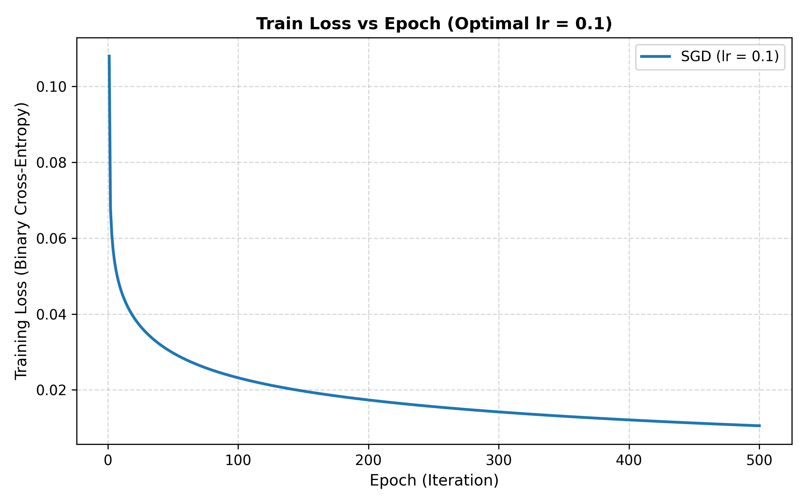

# Breast Cancer Prediction with Logistic Regression

**A binary classifier that predicts whether a breast tumour is malignant or benign from cell-nucleus measurements. Logistic regression written from scratch with NumPy and trained with stochastic gradient descent, with no machine-learning libraries.**

Built for the AI Lab course at United International University.


-lightgrey)

## Results

| Learning rate | Validation accuracy | Final training loss |
|:---:|:---:|:---:|
| **0.1** | **96.47%** (82 / 85) | **0.0105** |
| 0.01 | 95.29% (81 / 85) | 0.0247 |
| 0.001 | 96.47% (82 / 85) | 0.0451 |
| 0.0001 | 95.29% (81 / 85) | 0.0759 |

**Selected learning rate: 0.1.** Evaluated once on the held-out test set (86 samples):

| Metric | Value |
|---|---|
| Test accuracy | **93.02%** (80 / 86) |
| Malignant precision | 90.3% |
| Malignant recall | 90.3% |
| F1 (malignant) | 90.3% |

| | Predicted benign | Predicted malignant |
|---|:---:|:---:|
| **Actually benign** | 52 | 3 |
| **Actually malignant** | 3 | 28 |

Every number here is reproducible with one command, see [Run it](#run-it).



## Dataset
[Wisconsin Diagnostic Breast Cancer (WDBC)](https://archive.ics.uci.edu/dataset/17/breast+cancer+wisconsin+diagnostic) from the UCI Machine Learning Repository.

- **569 samples**: 357 benign, 212 malignant
- **30 numeric features**: the mean, standard error and worst value of ten measurements of each cell nucleus (radius, texture, perimeter, area, smoothness, compactness, concavity, concave points, symmetry, fractal dimension), computed from digitised images of a fine-needle aspirate
- The ID column is dropped and the diagnosis is encoded **malignant = 1, benign = 0**
- Files: [`data/wdbc.data`](data/wdbc.data), [`data/wdbc.names`](data/wdbc.names) (the dataset's own description)

## Method

1. **Split.** Shuffle once with seed 42, then cut 70 / 15 / 15 into 398 train, 85 validation and 86 test samples.
2. **Standardise.** Z-score every feature with the mean and standard deviation of the **training set only**, then apply them to validation and test. This avoids data leakage.
3. **Bias term.** Append a column of ones so the intercept is learned as one more weight.
4. **Train with per-sample SGD** (the weights update after every single sample), for 500 epochs at each of four learning rates.
5. **Select.** Choose the learning rate with the best validation accuracy, then evaluate it on the test set one time.

The model and update rule, per sample $(x, y)$:

$$h = \sigma(\theta^{\top}x) = \frac{1}{1 + e^{-\theta^{\top}x}}$$

$$J(\theta) = -y\log h - (1-y)\log(1-h)$$

$$\nabla_\theta J = x\,(h - y) \qquad\qquad \theta \leftarrow \theta - \text{lr}\cdot x\,(h - y)$$

A sample is classified as malignant when $h \ge 0.5$. Predictions are clipped away from 0 and 1 inside the log for numerical stability, and the sigmoid input is clipped to avoid overflow.

## What the results show
- **Stable convergence.** At lr = 0.1 the mean training loss falls from 0.108 (epoch 1) to 0.032 (epoch 40) and 0.0105 (epoch 500), with no oscillation or divergence.
- **Smaller steps are still converging.** After 500 epochs the final loss is 0.0247, 0.0451 and 0.0759 for lr = 0.01, 0.001 and 0.0001, so the smaller rates simply need more epochs.
- **A tie in validation accuracy.** lr = 0.1 and lr = 0.001 both score 82 / 85. The code keeps the first best score, so the larger rate wins, and its much lower training loss supports that choice.
- **Validation accuracy can't separate close models here.** With 85 validation samples, one sample is worth about 1.2 percentage points.
- **Test errors are balanced.** 3 benign tumours were flagged as malignant and 3 malignant tumours were missed.

## Limitations
- One random split and one seed: the numbers would move a little with a different split. The test set has only 86 samples, so one sample is about 1.2 points of accuracy.
- Accuracy alone isn't enough for a medical task. Missed malignant cases (false negatives) cost more than false alarms, so recall for the malignant class matters most.
- No regularisation, and samples are visited in the same order every epoch.
- This is a coursework project, **not a diagnostic tool**.

## Possible extensions
k-fold cross-validation for steadier estimates · L2 regularisation · a decision threshold tuned for higher recall · ROC / AUC · vectorised mini-batch training for speed · a comparison against scikit-learn's `LogisticRegression`.

## Run it
```bash
git clone https://github.com/splashahnaf445/Ai-with-Python.git
cd Ai-with-Python/Breast-Cancer-Logistic-Regression

python -m venv .venv
source .venv/bin/activate        # Windows: .venv\Scripts\activate
pip install -r requirements.txt

python src/logistic_regression.py            # opens the plot window at the end
python src/logistic_regression.py --no-show  # headless: just saves the files
```
Takes about 12 seconds. It prints the table above and writes [`results/train_loss_vs_epoch.png`](results/train_loss_vs_epoch.png) and [`results/metrics.txt`](results/metrics.txt). Seeds are fixed, so you get the same numbers every run.

Options: `--data PATH`, `--outdir PATH`, `--max-iter N`.

## Project structure
```text
Breast-Cancer-Logistic-Regression/
├── data/
│   ├── wdbc.data                   dataset (569 rows)
│   └── wdbc.names                  dataset description
├── src/
│   └── logistic_regression.py      loading, split, scaling, SGD, evaluation, plot
├── results/
│   ├── train_loss_vs_epoch.png     loss curve for the selected learning rate
│   └── metrics.txt                 full console output of the run
├── requirements.txt
└── README.md
```

## Data source and credit
Dua, D. and Graff, C., UCI Machine Learning Repository. Dataset creators: Dr. William H. Wolberg, W. Nick Street and Olvi L. Mangasarian (University of Wisconsin), donated 1995. Licensed CC BY 4.0.

## Author
Ahnaf Shahriar · [GitHub](https://github.com/splashahnaf445)
